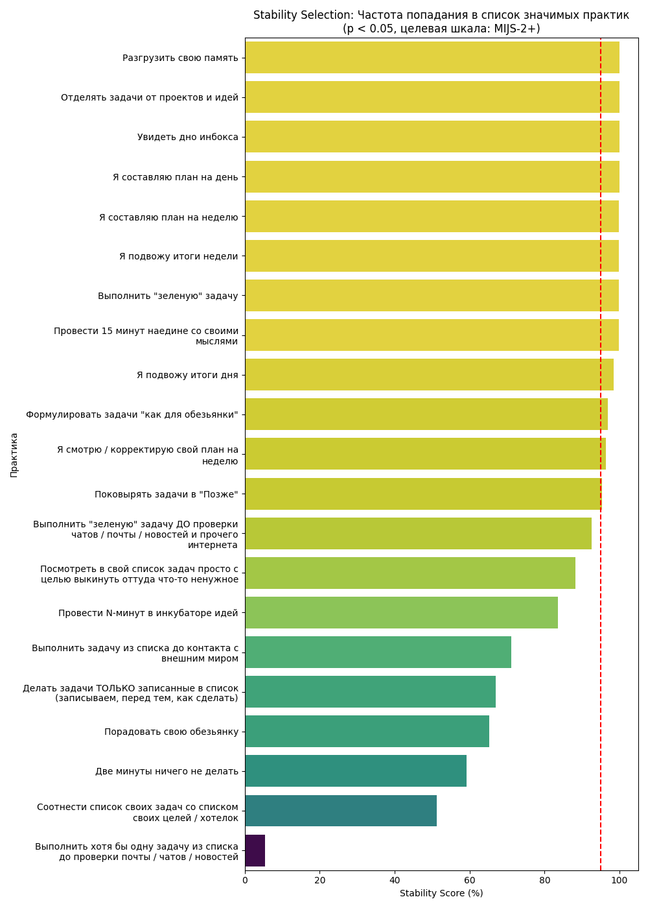
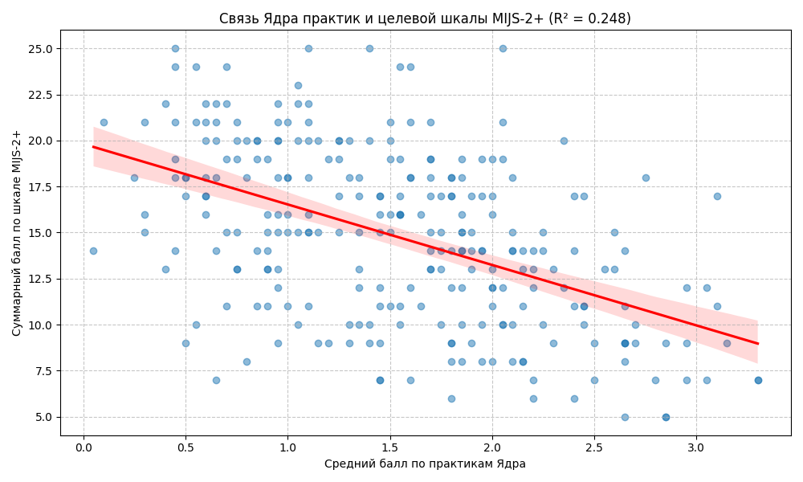

# Анализ устойчивости (Stability Selection)

Параметры: 1000 итераций, подвыборка 210 человек (~79%).
Целевая шкала: MIJS-2+
Отбор практик: все практики с скорректированным p-value < 0.05 (FDR Benjamini-Hochberg).
Консенсус: практика должна попасть в отобранные списки минимум 3 из 3 методов.
Stability Score показывает, в каком проценте случаев практика попадала в список консенсуса при случайных изменениях в выборке.

| № | Практика | Stability Score (%) | Статус |
| :--- | :--- | :---: | :--- |
| 1 | Разгрузить свою память | 100.0% | 🔥 Ядро (Strong) |
| 2 | Отделять задачи от проектов и идей | 100.0% | 🔥 Ядро (Strong) |
| 3 | Увидеть дно инбокса | 100.0% | 🔥 Ядро (Strong) |
| 4 | Я составляю план на день | 99.9% | 🔥 Ядро (Strong) |
| 5 | Я составляю план на неделю | 99.8% | 🔥 Ядро (Strong) |
| 6 | Я подвожу итоги недели | 99.8% | 🔥 Ядро (Strong) |
| 7 | Выполнить "зеленую" задачу | 99.8% | 🔥 Ядро (Strong) |
| 8 | Провести 15 минут наедине со своими мыслями | 99.8% | 🔥 Ядро (Strong) |
| 9 | Я подвожу итоги дня | 98.4% | 🔥 Ядро (Strong) |
| 10 | Формулировать задачи "как для обезьянки" | 96.9% | 🔥 Ядро (Strong) |
| 11 | Я смотрю / корректирую свой план на неделю | 96.3% | 🔥 Ядро (Strong) |
| 12 | Поковырять задачи в "Позже" | 95.4% | 🔥 Ядро (Strong) |
| 13 | Выполнить "зеленую" задачу ДО проверки чатов / почты / новостей и прочего интернета | 92.5% | ✅ Устойчивая |
| 14 | Посмотреть в свой список задач просто с целью выкинуть оттуда что-то ненужное | 88.3% | ✅ Устойчивая |
| 15 | Провести N-минут в инкубаторе идей | 83.6% | ✅ Устойчивая |
| 16 | Выполнить задачу из списка до контакта с внешним миром | 71.1% | ✅ Устойчивая |
| 17 | Делать задачи ТОЛЬКО записанные в список (записываем, перед тем, как сделать) | 67.0% | ✅ Устойчивая |
| 18 | Порадовать свою обезьянку | 65.3% | ✅ Устойчивая |
| 19 | Две минуты ничего не делать | 59.1% | ✅ Устойчивая |
| 20 | Соотнести список своих задач со списком своих целей / хотелок | 51.2% | ✅ Устойчивая |
| 21 | Выполнить хотя бы одну задачу из списка до проверки почты / чатов / новостей | 5.4% | ❌ Шумовая |
| 22 | Интернет-шаббат: провести день, не прикасаясь к устройствам, способным соединяться с интернетом | 4.3% | ❌ Шумовая |
| 23 | Сходить на тренировку и позаниматься спортом | 0.7% | ❌ Шумовая |
| 24 | Отключать средства коммуникации на время сосредоточенной работы (блоки тишины) | 0.3% | ❌ Шумовая |
| 25 | Закрыть ненужные вкладки в браузере | 0.2% | ❌ Шумовая |
| 26 | Лежа в постели не пользоваться устройствами с экранами | 0.0% | ❌ Шумовая |
| 27 | Провести утро без смартфона | 0.0% | ❌ Шумовая |
| 28 | Во время работы прятать смартфон от самого себя (не держать его на виду) | 0.0% | ❌ Шумовая |
| 29 | Пользоваться смартфоном в туалете | 0.0% | ❌ Шумовая |
| 30 | Вести лог дня (дневник) | 0.0% | ❌ Шумовая |
| 31 | Провести день стесняясь смартфона | 0.0% | ❌ Шумовая |
| 32 | Установить фильтр синего (ночной режим или режим чтения) на экранах | 0.0% | ❌ Шумовая |
| 33 | Провести ревизию спального места на предмет светового шума | 0.0% | ❌ Шумовая |
| 34 | Установить автоматический (по расписанию) режим "не беспокоить" на смартфоне (минимум на 8 часов в день) | 0.0% | ❌ Шумовая |
| 35 | Удалить приложения социальных сетей со своего смартфона | 0.0% | ❌ Шумовая |
| 36 | Отключить красные кружочки на иконках приложений в смартфоне | 0.0% | ❌ Шумовая |
| 37 | Установить плагины и настройки против рекламных баннеров | 0.0% | ❌ Шумовая |
| 38 | Отключить оповещения о новых сообщениях в чатах | 0.0% | ❌ Шумовая |
| 39 | Отключить оповещения о новых сообщениях в электронной почте | 0.0% | ❌ Шумовая |
| 40 | Отключить push-оповещения от приложений в смартфоне (соцсети, магазины, заправки) | 0.0% | ❌ Шумовая |
| 41 | Отключить оповещения на смарт-часах | 0.0% | ❌ Шумовая |
| 42 | Настроить автоматическое отмечание входящих писем в электронной почте прочитанными | 0.0% | ❌ Шумовая |

---

# Психометрический анализ 'Ядра' практик

В ядро вошли практики с устойчивостью >= 95%.

- **Альфа Кронбаха:** 0.857
- **Омега МакДональда:** 0.862

- **Корреляция с целевой шкалой (Pearson r):** -0.501
- **Корреляция с целевой шкалой (Spearman ρ):** -0.493

### Факторный анализ ядра

- **KMO:** 0.869
- **Тест Бартлетта:** p=0.0000

**Количество выделенных факторов (EV > 1):** 3
**Суммарная объясненная дисперсия (EFA, 3 факт.):** 45.4%
**Собственные числа (Eigenvalues) и полная дисперсия (PCA):**

| Фактор | Собств. число | % Полной дисперсии |
| :--- | :---: | :---: |
| 1 | 4.823 | 40.2% |
| 2 | 1.171 | 9.8% |
| 3 | 1.005 | 8.4% |
| 4 | 0.880 | 7.3% |
| 5 | 0.749 | 6.2% |
| 6 | 0.675 | 5.6% |
| 7 | 0.622 | 5.2% |
| 8 | 0.597 | 5.0% |
| 9 | 0.487 | 4.1% |
| 10 | 0.455 | 3.8% |
| 11 | 0.288 | 2.4% |
| 12 | 0.246 | 2.1% |

| Практика | Фактор 1 | Фактор 2 | Фактор 3 |
| :--- | :---: | :---: | :---: |
| Разгрузить свою память | 0.280 | 0.361 | 0.186 |
| Отделять задачи от проектов и идей | 0.175 | 0.807 | 0.120 |
| Увидеть дно инбокса | 0.123 | 0.261 | 0.349 |
| Я составляю план на день | 0.587 | 0.298 | 0.281 |
| Я составляю план на неделю | 0.773 | 0.243 | 0.237 |
| Я подвожу итоги недели | 0.594 | 0.190 | 0.390 |
| Выполнить "зеленую" задачу | 0.207 | 0.309 | 0.425 |
| Провести 15 минут наедине со своими мыслями | 0.221 | 0.085 | 0.577 |
| Я подвожу итоги дня | 0.520 | 0.150 | 0.413 |
| Формулировать задачи "как для обезьянки" | 0.150 | 0.495 | 0.262 |
| Я смотрю / корректирую свой план на неделю | 0.770 | 0.288 | 0.125 |
| Поковырять задачи в "Позже" | 0.303 | 0.482 | 0.112 |

### Прогностическая ценность 'Ядра'

Оценка связи между средним баллом по практикам 'Ядра' и целевой шкалой MIJS-2+.

- **Коэффициент детерминации (R²):** 0.251
- **Интерпретация:** Ядро практик объясняет **25.1%** дисперсии целевой шкалы.

